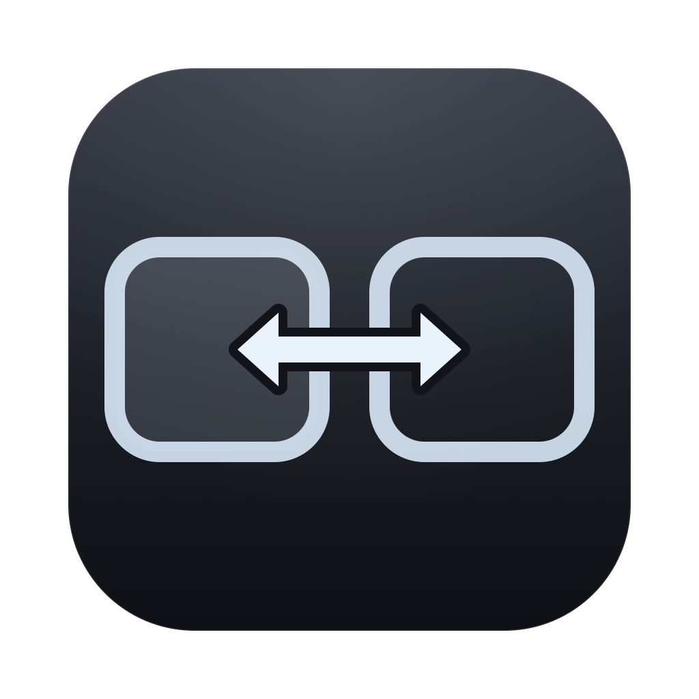

# MouseSwitcher


-green.svg)

> A tiny macOS menu bar utility: press `Option + ←` / `Option + →` to cycle
> your mouse pointer between displays.
>
> [中文](./README.md)



It lives in the top-right corner of your screen — an icon only, no app name:


---

## Why

macOS only lets you move the pointer across displays by pushing it against a
screen edge. With an external monitor — especially at a different resolution or
vertically offset — the pointer often gets stuck. MouseSwitcher moves the
pointer directly to the matching spot on the target display with a single
keypress, and cycles through displays.

---

## Features

- **`Option + →` / `Option + ←`** — global hotkeys to jump to the next / previous display
- **Wrapping** (on by default) — at the leftmost or rightmost display it wraps
  around, so you don't need to think about which direction to press; holding one
  key keeps cycling through every display
- **Preserve relative position** — the pointer lands at the same relative spot
  (e.g. 50% / 50% on the left display maps to 50% / 50% on the right one);
  can be turned off to land in the center instead
- **Real spatial geometry** — left/right is derived from `CGDisplayBounds`
  global coordinates, not from the order of the system display array, so offset
  and mixed-resolution layouts resolve correctly
- **Hot-plug and wake aware** — the display list refreshes automatically when you
  plug/unplug a monitor or wake from sleep
- **Menu bar only** — no Dock icon (`LSUIElement`), no windows
- **Universal binary** — runs on both Apple Silicon and Intel, no Rosetta needed
- **Launch at login** — toggleable from the menu

---

## Requirements

| | |
|---|---|
| OS | macOS 13.0 (Ventura) or later |
| Chip | Apple Silicon / Intel (universal binary) |
| Displays | **2 or more** — with a single display the hotkeys do nothing |

---

## Download and install

### 1. Download

Grab `MouseSwitcher-macos-universal.zip` from the
[Releases](https://github.com/FNQIP/MouseSwitcher/releases) page, unzip it, and
drag `MouseSwitcher.app` into `/Applications`.

You can verify the download against the `SHA256SUMS` published with the release:

```bash
shasum -a 256 -c SHA256SUMS
```

### 2. Gatekeeper may block the first launch ⚠️

This project is **ad-hoc signed only — it is not signed with a paid Apple
Developer ID and is not notarized**. On first launch macOS may say it comes from
an unidentified developer, or that the file is damaged. **That is not a broken
build.** Pick any one of these:

1. **Right-click** MouseSwitcher.app → **Open** → confirm **Open**
2. In Terminal:
   ```bash
   xattr -cr /Applications/MouseSwitcher.app
   ```
3. System Settings → Privacy & Security → scroll to **Security** → **Open Anyway**

### 3. You must grant Accessibility manually ⚠️

Controlling the pointer requires the Accessibility permission, and **it cannot be
granted automatically — only you can do it on your Mac**:

```
System Settings → Privacy & Security → Accessibility → enable MouseSwitcher
```

You can also click the menu bar icon → **Open System Settings…** to jump there.
No restart is needed; it takes effect within seconds. Until then the menu bar
icon shows a ⚠️ next to it.

> There is no Dock icon — that's normal for a menu bar app.
> Check the top-right corner of the screen to see whether it's running.

---

## Usage

| Action | Result |
|---|---|
| `Option + →` | Move the pointer to the next display (wraps around) |
| `Option + ←` | Move the pointer to the previous display (wraps around) |
| Click the menu bar icon | Open the menu |

From the menu you can pick a display to move to, toggle wrapping, toggle
preserving relative position, toggle launch at login, open System Settings,
**uninstall**, and quit.

**About wrapping:** the direction only sets the traversal order. Holding either
key cycles through every display; there is no dead end. With three or more
displays the middle ones still follow spatial neighbours — only the ends wrap.

---

## Uninstalling

**Option 1 — from the menu (recommended):** click the menu bar icon →
**"Uninstall MouseSwitcher…"** → confirm. It unregisters the login item, moves
the app to the **Trash**, clears its preferences, and opens the Accessibility
pane so you can remove the entry.

**Option 2 — script:**

```bash
./uninstall.sh
```

Same steps (the app is deleted outright instead of trashed), plus a `tccutil`
reset of the Accessibility entry.

**Option 3 — drag to the Trash:** removes the app itself, but **leaves behind**
the login item and preferences. Use one of the options above for a clean removal.

Either way, the **Accessibility entry** must be removed by hand — third-party
code cannot touch the TCC database: System Settings → Privacy & Security →
Accessibility → select MouseSwitcher → click **–**.

---

## Building from source

You do **not** need Xcode — only the **Xcode Command Line Tools**
(`xcode-select --install`) — and no Apple Developer account.

```bash
git clone https://github.com/FNQIP/MouseSwitcher.git
cd MouseSwitcher
./scripts/build-app.sh          # produces build/MouseSwitcher.app (arm64 + x86_64)
open build/MouseSwitcher.app
```

For personal use you can build your native architecture only, which is faster:

```bash
./scripts/build-app.sh --native
```

### Scripts

| Script | Purpose |
|---|---|
| `scripts/build-app.sh` | Build the app bundle (universal by default, supports `--version`) |
| `scripts/package-app.sh` | Package into `MouseSwitcher-macos-universal.zip` (optional `--dmg`) |
| `scripts/create-release.sh` | Generate `SHA256SUMS` and release notes |
| `install.sh` | Install to `/Applications` (falls back to `~/Applications`) |
| `run-app.sh` | Build and launch |
| `uninstall.sh` | Uninstall: drop the login item, remove the app (both locations), clear preferences and the Accessibility entry |
| `dist.sh` | Build a distributable bundle with an installer and instructions |

---

## Project layout

```text
MouseSwitcher/
├── Package.swift                 SwiftPM manifest
├── Info.plist                    App configuration (LSUIElement=true)
├── Sources/MouseSwitcher/        Swift sources
│   ├── AppDelegate.swift         App lifecycle
│   ├── StatusMenuController.swift Menu bar and menu
│   ├── DisplayManager.swift      Display enumeration and left/right resolution
│   ├── MouseManager.swift        Pointer movement
│   ├── HotKeyManager.swift       Global hotkeys (Carbon)
│   ├── PermissionManager.swift   Accessibility permission
│   ├── SettingsManager.swift     Preferences
│   ├── SwitchCoordinator.swift   Switch orchestration
│   ├── LaunchAtLoginManager.swift Launch at login
│   └── Diagnostics.swift         --diagnose / --move debug switches
├── Resources/                    App icon (.icns) and menu bar template images
├── Tools/make-icon.swift         Icon generator (CoreGraphics vector drawing)
├── scripts/                      Build / package / release scripts
└── .github/workflows/            GitHub Actions
```

The icon is not a bitmap asset — `Tools/make-icon.swift` draws it with
CoreGraphics as vectors and renders natively at each size, so it stays sharp from
16px to 1024px with no third-party dependencies.

---

## CI / CD

Two GitHub Actions workflows are configured:

| Trigger | Workflow | Result |
|---|---|---|
| push to `main` / pull request | `build.yml` | Build + verify + package, uploaded to **Actions Artifacts** |
| push a `v*` tag | `release.yml` | Also creates a **GitHub Release** with the zip, dmg and `SHA256SUMS` |

To cut a release:

```bash
git tag v1.0.0
git push origin v1.0.0
```

The Git tag is the single source of truth for the version; it is written into
`Info.plist` at build time, so you never maintain it in several places. A failed
build fails the workflow — broken artifacts are never published.

---

## Known limitations

- **Not notarized**: ad-hoc signed, so the first launch needs step 2 above.
  Removing that prompt entirely requires a paid Apple Developer Program
  membership (Developer ID signing + notarization).
- **Rebuilding invalidates the permission**: the ad-hoc signature changes on every
  build, so the previously granted Accessibility permission stops applying and
  must be re-enabled. In normal use (no rebuilds) this never happens.
- With a single display the hotkeys do nothing.

---

## Privacy

- No network access, no telemetry, no log uploads
- The only permission requested is **Accessibility**, used solely to read the
  display layout and move the pointer
- Logs go to the console by default and can be turned off from the menu
